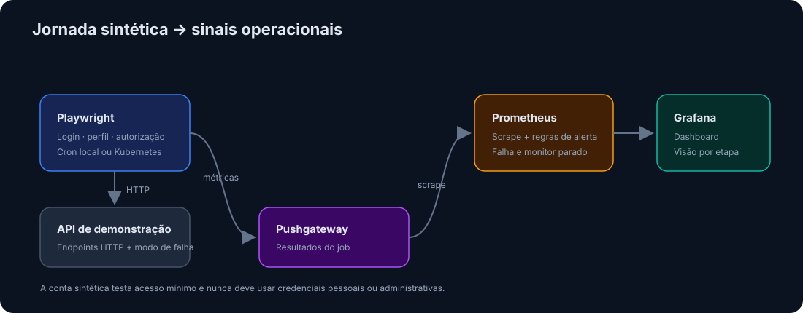

# Playwright Synthetic Monitoring Lab

Lab local de monitoramento sintético de APIs com Playwright, Prometheus e Grafana. Uma jornada automatizada autentica um usuário dedicado, verifica seu perfil e confirma que ele continua sem acesso administrativo. O resultado e o tempo de cada etapa viram métricas e alertas.

> Projeto demonstrativo. A API, as credenciais padrão e a rota de falhas são destinadas somente ao ambiente local. Não use os valores de exemplo em produção.



## O que demonstra

- Jornadas de API executadas pelo Playwright Test.
- Verificação de autenticação, autorização e privilégio mínimo.
- Métricas de sucesso, duração, retries e passos enviadas ao Pushgateway.
- Alertas Prometheus para falha e ausência de execuções recentes.
- Dashboard Grafana provisionado automaticamente.
- Execução local com Docker Compose e exemplo de CronJob Kubernetes.

## Arquitetura

1. O runner Playwright chama a API de demonstração.
2. A jornada testa login, consulta de perfil e negação de acesso administrativo.
3. O reporter envia métricas ao Pushgateway ao final de cada execução.
4. O Prometheus coleta as métricas e avalia as regras de alerta.
5. O Grafana apresenta resultados e duração por etapa.

## Executar localmente

Requisitos: Docker Compose v2.

```sh
cp .env.example .env
docker compose up --build
```

O runner executa a cada 60 segundos. Endpoints locais:

| Serviço | Endereço |
|---|---|
| API demo | http://localhost:3000 |
| Pushgateway | http://localhost:9091 |
| Prometheus | http://localhost:9090 |
| Grafana | http://localhost:3001 |

As credenciais do `.env.example` são descartáveis e existem apenas para o demo local. O arquivo `.env` é ignorado pelo Git. A aplicação de exemplo também expõe `/chaos` para provocar falhas e latência; não habilite esse endpoint em uma API real.

## Validação local e resultado esperado

Em 19 de novembro de 2026, a stack foi construída e executada com Docker Compose. A jornada `login-api` passou, as três etapas enviaram resultado `1` ao Pushgateway, o Prometheus retornou `synthetic_check_success{journey="login-api"} 1` e a API de saúde do Grafana respondeu com `database: ok`.

Para conferir no seu ambiente após subir a stack:

```sh
docker compose ps
docker compose logs --tail 30 synthetics
curl -fsS 'http://localhost:9090/api/v1/query?query=synthetic_check_success'
curl -fsS http://localhost:3001/api/health
```

São esperados os serviços ativos, `1 passed` no log do runner, valor `1` na resposta do Prometheus e `database: ok` no Grafana. A primeira coleta pode levar alguns segundos. Acesse o dashboard provisionado no Grafana para explorar as métricas por etapa.

Os cenários de falha, alertas e manifesto Kubernetes são exemplos para exploração; não foram validados nessa execução. Para encerrar a stack local, use `docker compose down`.

## Jornada `login-api`

| Etapa | Verificação |
|---|---|
| `login` | Login retorna token Bearer válido. |
| `perfil` | O token lê somente o perfil do usuário sintético. |
| `sem-privilegios` | A rota administrativa retorna `403`. |

O usuário de monitoramento deve ser separado de usuários reais e ter somente as permissões necessárias para a jornada. Não reutilize credenciais de produção ou de uma pessoa.

## Métricas e alertas

| Métrica | Uso |
|---|---|
| `synthetic_check_success` | Resultado final da jornada. |
| `synthetic_check_duration_seconds` | Duração total. |
| `synthetic_check_retries` | Retries consumidos pelo Playwright. |
| `synthetic_check_last_run_timestamp_seconds` | Detecção de monitor parado. |
| `synthetic_step_success` | Resultado de cada etapa. |
| `synthetic_step_duration_seconds` | Duração de cada etapa. |

Falhas podem ser simuladas no serviço demo:

```sh
curl -X POST http://localhost:3000/chaos -H 'content-type: application/json' -d '{"fail":"login"}'
curl -X POST http://localhost:3000/chaos -H 'content-type: application/json' -d '{"latencyMs":2500}'
curl -X POST http://localhost:3000/chaos -H 'content-type: application/json' -d '{}'
```

## Executar uma vez sem Compose

```sh
cd synthetics
npm install
BASE_URL=http://localhost:3000 \
SYNTH_USER=synthetic-bot \
SYNTH_PASSWORD=synthetic-pass \
PUSHGATEWAY_URL=http://localhost:9091 \
npx playwright test
```

## Exemplo Kubernetes

`k8s/cronjob.yaml` executa o mesmo container em um CronJob. Antes de aplicar:

1. Publique e fixe a imagem por versão ou digest.
2. Ajuste a URL da API e do Pushgateway para o seu ambiente.
3. Crie o Secret de credenciais fora do Git e use uma conta de monitoramento com acesso mínimo.
4. Ajuste o período de alerta ao intervalo do CronJob e configure o `honorLabels` no scrape do Pushgateway.
5. Revise recursos, política de rede, TLS e retenção de métricas para o seu cluster.

O manifesto é um ponto de partida e não provisiona API, Prometheus, Pushgateway nem Grafana no cluster.

## Limitações

- O Pushgateway é adequado a jobs de curta duração e não substitui métricas de serviços de longa execução.
- O exemplo possui uma única jornada e não cobre browser UI, rotação de credenciais ou múltiplos ambientes.
- O estado de falha da API demo é em memória e reinicia com o container.
- A composição local usa credenciais fracas intencionalmente para facilitar a demonstração.

## Licença

MIT. Consulte [LICENSE](LICENSE).
